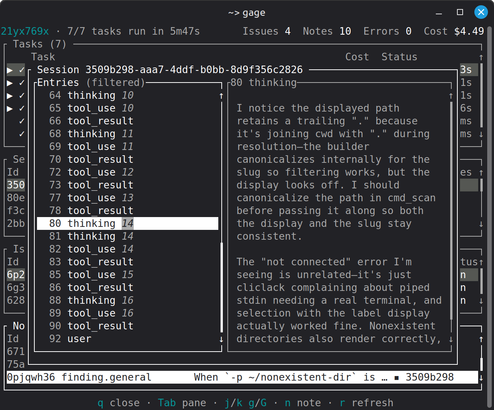

<!-- TODO: Add a logo above the title. -->

<h1 align="center">Gage</h1>

<p align="center">
  <strong>Unlock the value of your session logs.</strong>
  <br />
  Gage runs locally to search and scan.
</p>

<h3 align="center">
  <a href="https://docs.gage.io">docs.gage.io</a>
</h3>

<p align="center">
  <a href="https://gage.io">Website</a> ·
  <a href="https://docs.gage.io/start">Quick start</a> ·
  <a href="https://github.com/gageml/gage/issues">Report an issue</a>
</p>

<p align="center">
  <a href="https://github.com/gageml/gage/actions/workflows/build.yml"></a>
  <a href="https://github.com/gageml/gage/releases"></a>
  <a href="LICENSE.txt"></a>
</p>

<!-- TODO: Replace this screenshot with an animated demo: scan, issue, resolve. -->
<p align="center">
  
</p>

Your coding agent writes a log of every session. Those logs hold the design
discussions, the decisions, and the reasoning behind your code. They also hold
bugs that were diagnosed and never fixed, project rules that were quietly
broken, and tasks that were started and never finished. Gage lets you and your
agent search those sessions with SQL, scan them for issues, and resolve what
the scans find.

## What you can do with Gage

- **Answer "why is this code this way?"** Gage traces a line of code to the
  session that wrote it. You see the design discussion, the assumptions, the
  decision, and the alternatives that were considered.
- **Resume unfinished tasks.** Ask your agent which tasks were started and not
  completed. You get a list of loose ends across all your sessions.
- **Take up one task in a new session.** Sessions wander as new ideas come up.
  A new session reads the earlier one through Gage and continues the task you
  name.
- **Back up sessions.** Session history holds the thinking behind your code.
  Coding agents delete old sessions. Gage keeps a copy and backs it up to a Git
  remote that you choose.
- **Review design rationale, not just code.** A code review needs the reasons
  for a change. Those reasons are in the session record.
- **Automate session scans.** Scanners turn a one-time question into a
  repeatable check. You can write a scanner for any policy, review, or
  measurement.

## Works with

Gage works with Claude Code, Codex, and Pi.

Support is planned for OpenCode, Cursor, Copilot CLI, Factory Droid, and Gemini
CLI.

## Quick start

Requirements:

- Linux (x86_64) or macOS (Apple Silicon)
- Claude Code, Codex, or Pi with an active login

Gage uses your coding agent to scan sessions and resolve issues. Token usage is
handled through that agent according to your plan.

```shell
# Install Gage
curl -fsSL https://gage.io/install.sh | sh

# Set up Gage in each coding agent that is installed
gage init

# Scan your recent sessions
gage scan

# List the open issues
gage issue list

# Resolve the issues that the scan found
gage resolve
```

See [Install](#install) for other installation methods.

## Search your sessions

Gage reads your sessions as SQL tables. There is no database to set up.

```shell
# Start an interactive SQL prompt
gage query

# Search the text of every message
gage query "select * from message_text('store layout')"
```

`gage init` installs a plugin that gives your coding agent the same access. Ask
a question in plain words and your agent answers from the sessions.

```text
Why does the session parser skip compressed entries?
```

`gage blame` goes from a line of code to the session and tool call that wrote
it.

```shell
gage blame src/index.rs -l 40-72
```

See [_Recall a decision_](https://docs.gage.io/how-to/recall) and
[_See context for a code change_](https://docs.gage.io/how-to/blame).

## Find issues

Scanners read your sessions and surface issues you would otherwise never see.
These include bugs left unfixed, agent behavior that worked against you, and
settings that cost you data.

<p align="center">
  
  <br />
  <em>Find real issues backed by evidence</em>
</p>

## Fix issues

`gage resolve` opens an interactive session in your coding agent that works
through open issues with you. You decide what gets fixed and what gets skipped.

<p align="center">
  
  <br />
  <em>Work interactively to apply fixes</em>
</p>

## Trace everything

Every issue cites its evidence. You can walk from an issue to its notes and
then to the exact session content behind it, thinking blocks included.

<p align="center">
  
  <br />
  <em>Trace the issue to the offending entry</em>
</p>

## Keep sessions local

Gage runs locally and stores its data under `~/.gage/`. Nothing leaves your
machine unless you run a command that sends it, such as `gage push` or
`gage backup`. Gage uses a Git-style workflow for backup and for sharing with
people you trust. See [PRIVACY.md](PRIVACY.md).

## Scanners

Gage ships these scanners in the `default` group. Their source is under
[scanners](/scanners) in this repository.

<table>
  <tr>
    <th>Scanner</th>
    <th>What it finds</th>
  </tr>
  <tr>
    <td><a href="/scanners/general"><code>general</code></a></td>
    <td>
      Session-level problems worth your attention: unresolved errors, agent
      behavior that worked against you, work left in a broken state
    </td>
  </tr>
  <tr>
    <td><a href="/scanners/code-review"><code>code-review</code></a></td>
    <td>
      Code quality problems in work performed during sessions, checked against
      your project's own rules
    </td>
  </tr>
  <tr>
    <td><a href="/scanners/findings"><code>findings</code></a></td>
    <td>
      Underlying problems that show up across findings from other scanners,
      reported as one issue per problem
    </td>
  </tr>
  <tr>
    <td>
      <a href="/scanners/hidden-thinking"><code>hidden-thinking</code></a>
    </td>
    <td>
      Sessions where model thinking text is hidden, which limits later
      analysis of agent behavior
    </td>
  </tr>
  <tr>
    <td>
      <a href="/scanners/session-retention"><code>session-retention</code></a>
    </td>
    <td>
      An unset session retention policy, which risks silent loss of session
      history
    </td>
  </tr>
</table>

## Install

Gage supports Linux (x86_64) and macOS (Apple Silicon). Windows support is
planned.

### Prebuilt binary

```shell
curl -fsSL https://gage.io/install.sh | sh
```

The script installs the `gage` binary to `~/.local/bin`, or to `$XDG_BIN_HOME`
if that variable is set. It does not require elevated privileges.

### `cargo binstall`

```shell
cargo binstall --git https://github.com/gageml/gage gage-cli
```

### From source

Building from source requires the [Rust toolchain](https://rustup.rs/).

```shell
git clone https://github.com/gageml/gage.git
cd gage
cargo install --path gage-cli
```

### Coding agent plugin

Gage requires a plugin in your coding agent. `gage init` installs it in Claude
Code, Codex, and Pi, in each one that is installed:

```shell
gage init
```

## Documentation

Full documentation is available at [docs.gage.io](https://docs.gage.io/docs/).

- [Quick start](https://docs.gage.io/start)
- [Sessions](https://docs.gage.io/sessions)
- [Scans](https://docs.gage.io/scans)
- [Scanners](https://docs.gage.io/scanners)
- [Issues](https://docs.gage.io/issues)
- [Notes](https://docs.gage.io/notes)
- [Resolve](https://docs.gage.io/resolve)
- [Query](https://docs.gage.io/commands/query)
- [Backup](https://docs.gage.io/commands/backup)
- [Uninstall](https://docs.gage.io/uninstall)

Problems that are known and not planned to be fixed are listed in
[KNOWN_ISSUES.md](KNOWN_ISSUES.md).

## FAQ

### Where is Gage data stored?

Gage writes all of its data to files under `~/.gage/`. These include:

- Configuration (`~/.gage/config.toml`)
- Installed scanners (`~/.gage/lib/scanners/`)
- Notes and issues (`~/.gage/store.git/`)
- Scan records (`~/.gage/scans/`)
- Cache and temporary files (`~/.gage/cache/`, `~/.gage/tmp/`)
- Logs (`~/.gage/log/`)

### Does Gage "phone home" for any reason?

No. Gage runs locally and writes all state under `~/.gage/`. Gage sends data to
another location only when you run a command that does so, such as `gage push`
or `gage backup`.

Gage provides tools to your coding agent over a local MCP server. The agent is
free to use these tools within the constraints of user-defined permissions
(allow and deny). Gage tools do not open network connections or otherwise write
outside of `~/.gage/`. The agent, however, may. This is the normal risk profile
of running an agent. To minimize the risk of sensitive data exfiltration, follow
the safeguards recommended by the vendor of your agent.

See [PRIVACY.md](PRIVACY.md) for the full privacy statement.

## Contributing

See [CONTRIBUTING.md](CONTRIBUTING.md).

## License

[Apache 2](LICENSE.txt)
