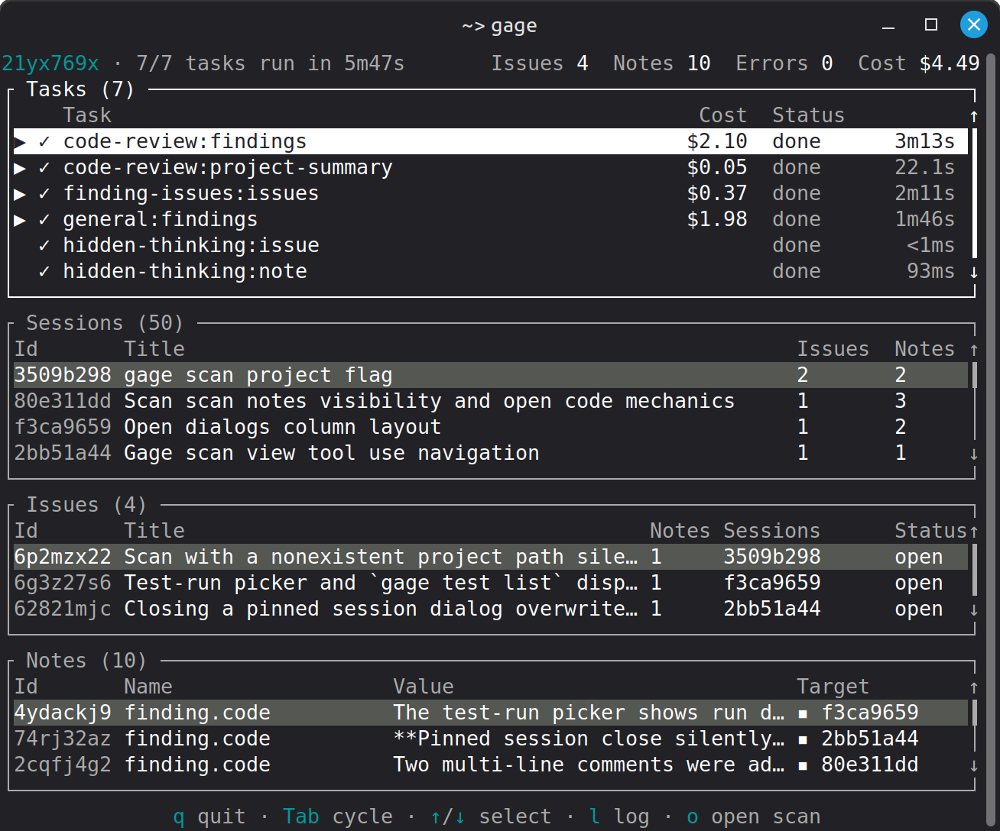
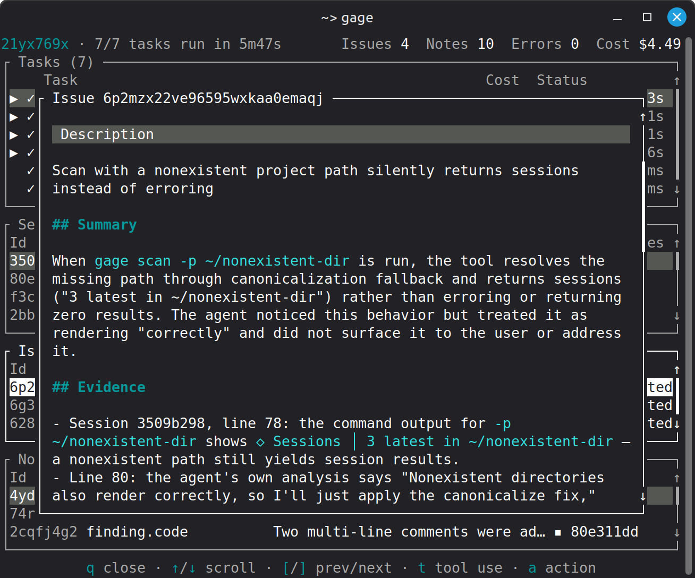
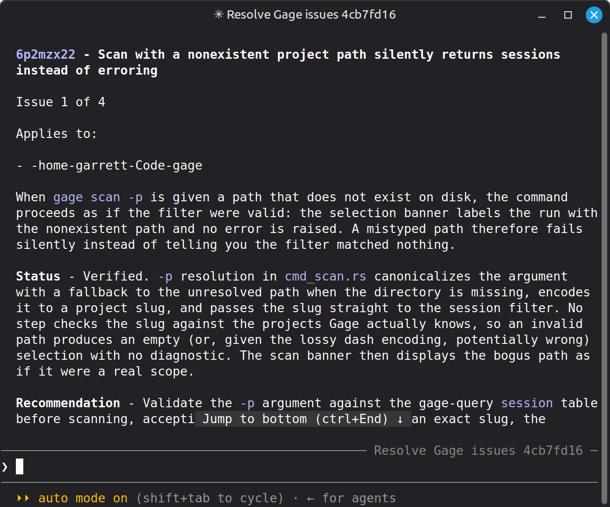

<!-- TODO: Add a logo above the title. -->

<h1 align="center">Gage</h1>

<p align="center">
  <strong>Scan Claude sessions to find and fix hidden issues.</strong>
</p>

<p align="center">
  <a href="https://gage.io">Website</a> ·
  <a href="https://gage.io/docs/">Documentation</a> ·
  <a href="https://github.com/gageml/gage/issues">Report an issue</a>
</p>

<p align="center">
  <a href="https://github.com/gageml/gage/actions/workflows/build.yml"></a>
  <a href="https://github.com/gageml/gage/releases"></a>
  <a href="LICENSE.txt"></a>
</p>

<!-- TODO: Replace this screenshot with an animated demo: scan, issue, resolve. -->
<p align="center">
  
</p>

Coding agents do a lot of work you never see. Buried in your Claude Code
transcripts are diagnosed-but-unfixed bugs, quietly violated project rules, and
agent behavior that worked against you. Gage scans those transcripts, turns what
it finds into actionable issues, and uses Claude Code itself to help you resolve
them.

## Highlights

- Finds bugs that were diagnosed in a session and never fixed.
- Checks the work done in sessions against your project's own rules.
- Cites evidence for every issue, down to the session entry behind it.
- Resolves issues in an interactive Claude Code session that you control.
- Runs locally and stores its data under `~/.gage/`. Nothing leaves your machine
  unless you push or publish it.
- Queries sessions, notes, and issues with SQL in the PostgreSQL dialect.
- Ships scanners as readable source under [scanners](/scanners).

## Quick start

Requirements:

- Linux (x86_64) or macOS (Apple Silicon)
- Claude Code with an active login (Pro plans recommended)

Gage uses Claude Code to scan sessions and resolve issues. Token usage is
handled through Claude Code according to your Anthropic plan.

```shell
# Install Gage
curl -fsSL https://gage.io/install.sh | sh

# Install the Claude Code plugin
gage init

# Scan your recent sessions
gage scan

# Resolve the issues that the scan found
gage resolve
```

See [Install](#install) for other installation methods.

## Find issues

Scanners read your Claude Code sessions and surface issues you would otherwise
never see: bugs left unfixed, agent behavior that worked against you, settings
that cost you data.

<p align="center">
  
  <br />
  <em>Find real issues backed by evidence</em>
</p>

## Fix issues

`gage resolve` opens an interactive Claude Code session that works through open
issues with you. You decide what gets fixed and what gets skipped.

<p align="center">
  
  <br />
  <em>Work interactively to apply fixes</em>
</p>

## Trace everything

Every issue cites its evidence. Walk from an issue to its notes to the exact
session content behind it --- thinking blocks included --- or query everything
directly with SQL.

<p align="center">
  
  <br />
  <em>Trace the issue to the offending entry</em>
</p>

## Scanners

Gage ships these scanners in the `default` group. Their source is under
[scanners](/scanners) in this repository.

<table>
  <tr>
    <th>Scanner</th>
    <th>What it finds</th>
  </tr>
  <tr>
    <td><a href="/scanners/general"><code>general</code></a></td>
    <td>
      Session-level problems worth your attention: unresolved errors, agent
      behavior that worked against you, work left in a broken state
    </td>
  </tr>
  <tr>
    <td><a href="/scanners/code-review"><code>code-review</code></a></td>
    <td>
      Code quality problems in work performed during sessions, checked against
      your project's own rules
    </td>
  </tr>
  <tr>
    <td><a href="/scanners/findings"><code>findings</code></a></td>
    <td>
      Underlying problems that show up across findings from other scanners,
      reported as one issue per problem
    </td>
  </tr>
  <tr>
    <td>
      <a href="/scanners/hidden-thinking"><code>hidden-thinking</code></a>
    </td>
    <td>
      Sessions where model thinking text is hidden, which limits later
      analysis of agent behavior
    </td>
  </tr>
  <tr>
    <td>
      <a href="/scanners/session-retention"><code>session-retention</code></a>
    </td>
    <td>
      An unset session retention policy, which risks silent loss of session
      history
    </td>
  </tr>
</table>

## Install

Gage supports Linux (x86_64) and macOS (Apple Silicon). Windows support is
planned.

### Prebuilt binary

```shell
curl -fsSL https://gage.io/install.sh | sh
```

The script installs the `gage` binary to `~/.local/bin`, or to `$XDG_BIN_HOME`
if that variable is set. It does not require elevated privileges.

### `cargo binstall`

```shell
cargo binstall --git https://github.com/gageml/gage gage-cli
```

### From source

Building from source requires the [Rust toolchain](https://rustup.rs/).

```shell
git clone https://github.com/gageml/gage.git
cd gage
cargo install --path gage-cli
```

### Claude Code plugin

Gage requires a Claude Code plugin. Install it by running:

```shell
gage init
```

## Documentation

Full documentation is available at [gage.io/docs](https://gage.io/docs/).

- [Quick start](https://gage.io/docs/start)
- [Scans](https://gage.io/docs/scans)
- [Scanners](https://gage.io/docs/scanners)
- [Issues](https://gage.io/docs/issues)
- [Notes](https://gage.io/docs/notes)
- [Resolve](https://gage.io/docs/resolve)
- [Query](https://gage.io/docs/commands/query)
- [Uninstall](https://gage.io/docs/uninstall)

Problems that are known and not planned to be fixed are listed in
[KNOWN_ISSUES.md](KNOWN_ISSUES.md).

## FAQ

### Where is Gage data stored?

Gage writes all of its data to files under `~/.gage/`. These include:

- Configuration (`~/.gage/config.toml`)
- Installed scanners (`~/.gage/lib/scanners/`)
- Notes and issues (`~/.gage/store.git/`)
- Scan records (`~/.gage/scans/`)
- Cache and temporary files (`~/.gage/cache/`, `~/.gage/tmp/`)
- Logs (`~/.gage/log/`)

### Does Gage "phone home" for any reason?

No. Gage runs locally and writes all state under `~/.gage/`. Gage sends data to
another location only when you run a command that does so, such as `gage push`
or `gage backup`.

Gage provides tools to Claude Code over a local MCP server. Claude is free to
use these tools within the constraints of user-defined permissions (allow and
deny). Gage tools do not open network connections or otherwise write outside of
`~/.gage/`. Claude, however, may. This is the normal risk profile of running an
agent. To minimize the risk of sensitive data exfiltration, follow the
safeguards recommended by Anthropic.

See [PRIVACY.md](PRIVACY.md) for the full privacy statement.

## Contributing

See [CONTRIBUTING.md](CONTRIBUTING.md).

## License

[Apache 2](LICENSE.txt)
